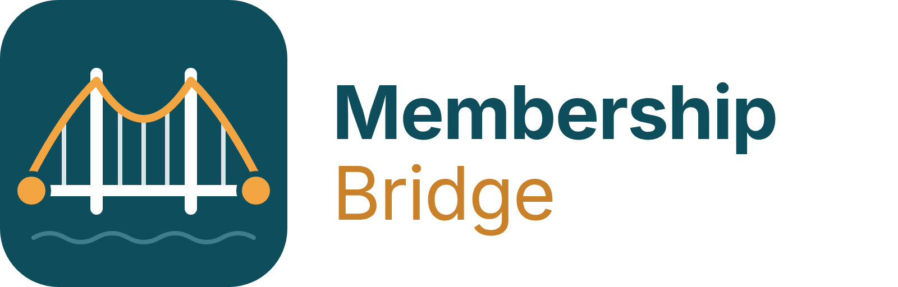

# Membership Bridge #

<picture>
  <source media="(prefers-color-scheme: dark)" srcset="docs/images/membership-bridge-logo-dark.png">
  
</picture>

Connects Moodle to the iMIS association management system. It sends learners'
results to iMIS, keeps enrolments in step with iMIS registrations, and mirrors iMIS
tutorial groups into Moodle course groups.

It talks to iMIS through a selectable **connection provider**: the ATS
`wsmoodle.asmx` SOAP bridge (the default), or the iMIS REST API directly (see
`docs/PROVIDERS.md`). A separate **sync provider** setting chooses which one runs the
enrolment syncs, so results can go one way and syncs run the other.

Key behaviours:

* **Results to iMIS.** Course completion and (graded, non-preview) quiz submissions
  queue an adhoc task that records the result in iMIS, with retry on failure.
  Activity completions can be sent as notes too (opt-in).
* **Activity scores** (opt-in per activity type): when an activity of a type ticked
  in *Push activity scores* is graded, for example a tutor marking an assignment
  or case study, its score is sent to iMIS as a note. The list covers every
  gradable activity installed; an unchanged regrade is not sent again.
* **Enrolments.** Nightly scheduled tasks run a full enrolment and cancellation
  sync, and a per-member sync can be queued at login so iMIS round-trips never
  block the login request. Each switch can be turned off.
  * Through **ATS**, ATS performs the enrolments by calling Moodle web services.
  * With the **registration sync over REST** (opt-in, 1.21.0), Moodle reads
    registrations from iMIS itself: it enrols active registrants (creating missing
    accounts) and suspends cancelled ones. It has a dry run (on by default), a
    look-back window and a suspension guard.
* **Cancellation without data loss.** The `local_membershipbridge_cancel_enrolment`
  web service function lets the ATS bridge *suspend* a cancelled learner (grades and
  completion kept) instead of hard-unenrolling them. ATS's unenrol mapping must be
  pointed at it (`docs/ADMIN-GUIDE.md`, Step 6).
* **Tutorial group sync** (opt-in): a nightly scheduled task reads the iMIS tutorial
  panel over REST and makes each course's groups match it. It uses the REST settings
  whichever provider is selected, and has a dry run and a removal guard. Rows with
  the panel's **Tutor** checkbox ticked (2.1.0) also give that person the tutor role
  in the course (Non-editing teacher by default), enrolling them if needed;
  unticking it removes the role.
* **Results back-fill.** A command-line tool (`cli/backfill.php --course=ID`) sends
  one course's existing completions and/or activity scores to iMIS, as if each had
  just happened. A dry run unless `--execute` is given.
* **Manual sync controls** (Site administration > Plugins > Local plugins > *Manual
  sync controls*, also reached from the settings page's *Open sync admin* button):
  a read-only connection test, a one-member manual sync (a member ID is required)
  and test controls for pushing a single completion or module note.
* **Audit trail.** Every call made to iMIS is recorded in an integration audit log
  (*Open integration audit log*), with credentials redacted; old entries are pruned
  on a configurable schedule. Results sent, manual syncs and back-fills also
  trigger Moodle events (2.3.0), so they appear in the standard logs and reports.
* **Completions export.** The `local_membershipbridge_get_completions_since` web
  service function lets an external system read completions and grades changed
  since a given time.
* **Privacy.** Implements Moodle's Privacy API, covering the audit log, the
  score-tracking table and results still queued to be sent.

## Requirements ##

* Moodle 5.1 to 5.3 LTS.
* PHP 8.2 or later (PHP 8.3+ on Moodle 5.2+).
* For the ATS SOAP bridge: the PHP `soap` extension, network access from the
  Moodle server to the ATS WSDL endpoint, and an ATS-issued API AuthToken (format
  `MO-xxxxxx`).
* For direct REST (including the tutorial group sync): network access to the iMIS
  site and a dedicated iMIS service account.

## Installing via uploaded ZIP file ##

1. Log in to your Moodle site as an admin and go to _Site administration >
   Plugins > Install plugins_.
2. Upload the ZIP file with the plugin code. You should only be prompted to add
   extra details if your plugin type is not automatically detected.
3. Check the plugin validation report and finish the installation.

## Installing manually ##

The plugin can be also installed by putting the contents of this directory to

    {your/moodle/dirroot}/local/membershipbridge

Afterwards, log in to your Moodle site as an admin and go to _Site administration
> Notifications_ to complete the installation.

Alternatively, you can run

    $ php admin/cli/upgrade.php

to complete the installation from the command line.

## Configuration ##

After installation, configure the plugin under _Site administration > Plugins >
Local plugins > Membership Bridge_. `docs/ADMIN-GUIDE.md` walks through it step by
step.

> **Before entering any connection details, turn the automatic writes off.**
> Completion and quiz pushes, the three login syncs and the three nightly tasks all
> default to enabled, so saving the connection first makes the plugin write straight
> away. See `docs/TESTING.md` §1.

* **Connection provider**: *ATS SOAP bridge* (default) or *Direct REST API*.
* **Sync provider**: which provider runs the enrolment, cancellation and group
  syncs; blank follows the connection provider.
* **ATS SOAP bridge WSDL URL**: the `wsmoodle.asmx?WSDL` endpoint for your
  environment (ask ATS for the correct host). Blank by default; no SOAP call is
  made until it is set. **Service endpoint URL (override)** forces the SOAP host
  when the WSDL embeds a different environment's address.
* **ATS API AuthToken**: the `MO-xxxxxx` token issued by ATS.
* **Member ID source**: the Moodle user field that holds the iMIS member ID
  (username, ID number or email). Defaults to username; set it to whichever field
  your identity provider fills with the iMIS ID (ID number where SAML2 matches on
  `idnumber`). **Member ID format** can limit IDs to digits only, so accounts such
  as admin are never sent.
* **Connection timeout (seconds)**: how long to wait on iMIS before giving up.
* **Default credit type** and **Credit value course field**: used by the direct
  REST provider only, and only when the matching activity column settings are filled
  in. The ATS SOAP `MoodleUpdate` does not carry credit; iMIS derives it from the
  product.
* **REST connection**: base URL (the iMIS site root, no `/api`), service-account
  username and password. Needed for the REST provider **and** for the tutorial
  group sync and the REST registration sync.
* **Automatic sync controls** and **Scheduled tasks**: one switch per automatic
  write, including *Push activity scores* (the activity types to send).
* **Registration sync (Direct REST API)**: the registrations IQA, dry run (on by
  default), account creation, cancelled status codes, look-back days (default 7
  after the event ends; needs an `EndDate` column; a one-member manual sync can
  override it) and the suspension guard.
* **Course mapping**: how an iMIS event maps to a Moodle course, either the course
  ID number or a lookup IQA. **Course mapping overrides** win over both. **Push
  course id overrides** change the course number sent to iMIS.
* **Tutorial group sync**: enable switch (off by default), dry run (on by default),
  removal guard, the tutorial panel and field names, and the *Tutor field* and
  *Tutor role* used for tutors.
* **Audit log**: enable/disable logging, set the retention period (days), and
  optionally capture full request/response payloads (off by default) while
  debugging.

Scheduled task times (all editable under _Site administration > Server >
Scheduled tasks_): enrolment sync 02:00, cancellation sync 02:15, group sync
02:30, tutorial group sync 02:45, audit-log cleanup 03:45.

## Documentation ##

* `docs/ADMIN-GUIDE.md`: setup, day-to-day use and troubleshooting, for site
  administrators.
* `docs/STAFF-GUIDE.md`: what the plugin does to courses, for teachers, tutors and
  support staff.
* `docs/freshdesk/`: HTML versions of the two guides, for a Freshdesk knowledge base.
* `docs/SETUP.md`: setting the plugin up for any iMIS: what to build in iMIS and
  which settings to fill in.
* `docs/CHANGEOVER-CHECKLIST.md`: SCCA's go-live runbook: switching from the vendor
  plugin, and the tutorial group sync go-live.
* `docs/TESTING.md`: configuring and testing safely, including against production.
* `docs/TEST-CHECKLIST.md`: step-by-step pre-testing checklist.
* `docs/TEST-PLAN.md`: the living test matrix.
* `docs/PROVIDERS.md`: the connection-provider design.
* `docs/DIRECT-REST-ARCHITECTURE.md`: the direct iMIS REST design.
* `docs/VENDOR-ARCHITECTURE.md`, `docs/DESIGN-NOTES.md`: the vendor bridge and
  the lessons taken from it.
* `docs/IMPROVEMENT-PLAN.md`: the roadmap.
* `CHANGELOG.md`: what changed in each release.
* `imis/`: pages that live in iMIS, such as the event dashboard's *Tutorial
  Groups* tab (`imis/tutorial-groups.html`). Not part of the plugin zip.

## Trademarks ##

iMIS is a trademark of Advanced Solutions International, Inc. Moodle is a
trademark of Moodle Pty Ltd. This project is independent: it is not affiliated
with, sponsored or endorsed by Advanced Solutions International, ATS (the vendor of
the `wsmoodle` bridge) or Moodle Pty Ltd. Their names are used only to describe the
systems this plugin works with.

## License ##

2024 Vernon Spain

This program is free software: you can redistribute it and/or modify it under
the terms of the GNU General Public License as published by the Free Software
Foundation, either version 3 of the License, or (at your option) any later
version.

This program is distributed in the hope that it will be useful, but WITHOUT ANY
WARRANTY; without even the implied warranty of MERCHANTABILITY or FITNESS FOR A
PARTICULAR PURPOSE. See the GNU General Public License for more details.

You should have received a copy of the GNU General Public License along with
this program. If not, see <https://www.gnu.org/licenses/>.
